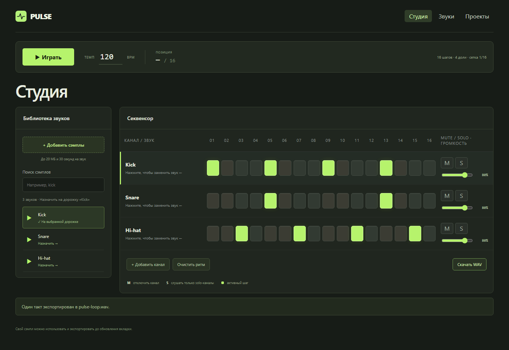
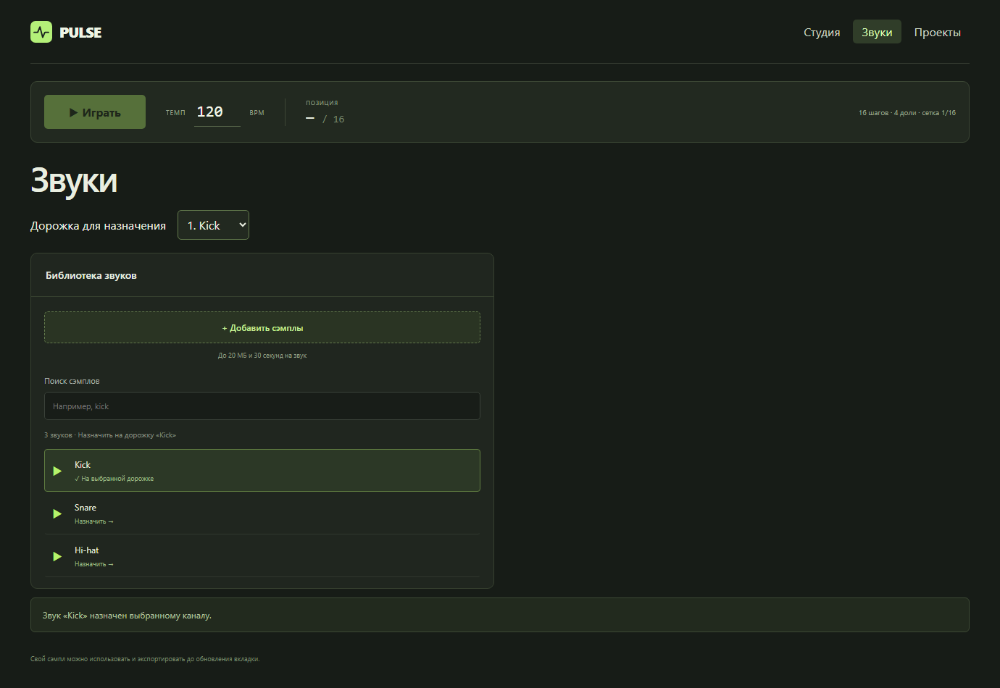
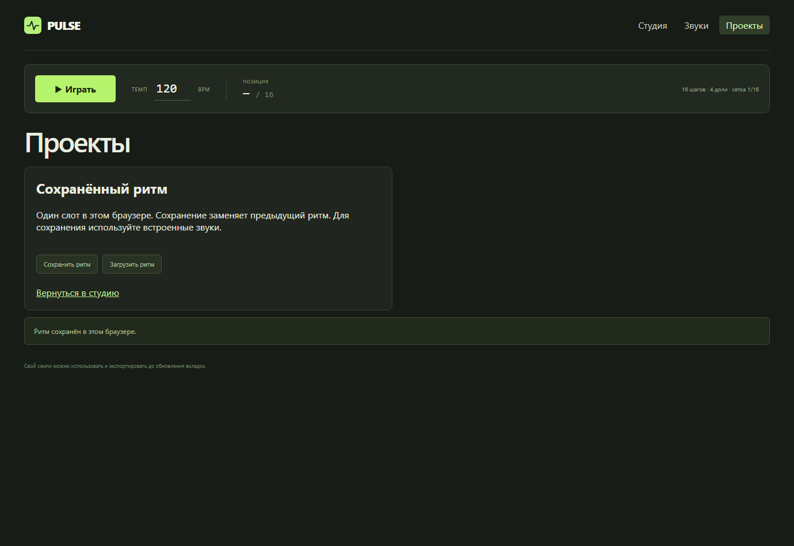

# PULSE — браузерная драм-машина

Курсовой проект, лабораторная работа №6. PULSE продолжает секвенсор BEAT LAB из четвёртой лабораторной. Можно собрать такт на 16 шагов, назначить встроенные или свои звуки, прослушать ритм, сохранить его в браузере и скачать один такт в WAV. PULSE состоит из веб-приложения и библиотеки React-компонентов `@pulse/ui`.

- [Архитектура](architecture.md)
- [Основной сценарий и границы MVP](mvp.md)

## Запуск

Нужен Node.js 22.12+ или современная LTS-версия. В PowerShell из корня репозитория:

```powershell
cd ui-library
npm.cmd ci
npm.cmd run build
cd ../frontend
npm.cmd ci
npm.cmd run dev
```

Откройте адрес из терминала, обычно `http://127.0.0.1:5173/`.

1. В студии включите у Kick шаги 1, 5, 9 и 13 и нажмите «Играть».
2. Измените BPM или громкость дорожки. M выключает дорожку, S оставляет звучать только дорожки с включённым solo.
3. Откройте «Звуки», выберите дорожку и назначьте другой звук. Там же можно загрузить и прослушать свой сэмпл. Библиотека доступна и слева в студии.
4. Нажмите «Стоп». Для демонстрации сохранения оставьте на дорожках встроенные звуки. В «Проектах» нажмите «Сохранить ритм».
5. Обновите страницу, нажмите «Загрузить ритм» и вернитесь в студию. Проверьте BPM и активные шаги.
6. Нажмите «Скачать WAV» и откройте `pulse-loop.wav`. При 120 BPM один такт длится 2 секунды. Громкость, mute и solo учитываются при экспорте. Пользовательские сэмплы можно экспортировать, пока открыта вкладка.

## Проверки

В каждой из папок `ui-library` и `frontend` есть команды:

```powershell
npm.cmd run lint
npm.cmd run lint:fix
npm.cmd test
npm.cmd run test:coverage
npm.cmd run build
```

Для разработки библиотеки `npm.cmd run dev` в `ui-library` пересобирает пакет при изменениях. Приложение запускается отдельно командой `npm.cmd run dev` в `frontend`.

## Скриншоты

Студия с отредактированным тактом:



Страница звуков с выбором дорожки:



Подтверждение сохранения ритма перед перезагрузкой:


